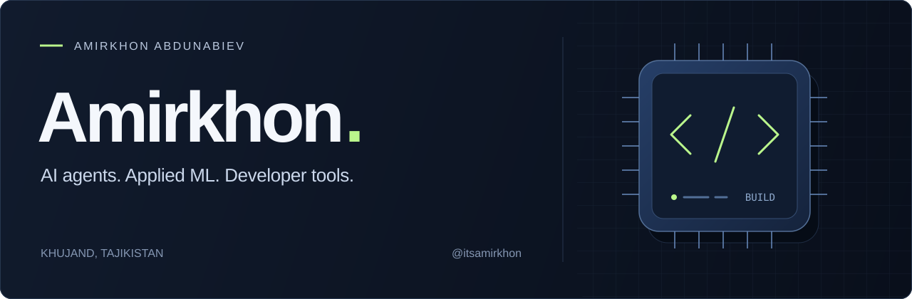

  

I build software around **AI agents, documents, and data** — from a finance assistant in Telegram to tools for legal research and credit verification. I work mainly with **Python and TypeScript**, connecting models to the tools and interfaces people use.

[LinkedIn ↗](https://www.linkedin.com/in/amirkhon-abdunabiev/) · [X / @thisisamirkhon ↗](https://x.com/thisisamirkhon)

## Selected work

<table>
<tr>
<td width="50%" valign="top">

### [01 / Findo ↗](https://github.com/itsamirkhon/findo)
**Personal finance, through conversation.**

Send a transaction, receipt, or voice note in Telegram. Findo turns it into a categorized entry in Google Sheets and answers questions about your spending.

PYTHON · TELEGRAM · TOOL CALLING

</td>
<td width="50%" valign="top">

### [02 / Lex ↗](https://github.com/itsamirkhon/lex)
**Specialist agents for legal workflows.**

Contract review, compliance checks, and legal research with source-cited deliverables and human review. Built for the Munich Hacking Legal Challenge.

TYPESCRIPT · PI · NEXT.JS

</td>
</tr>
<tr>
<td width="50%" valign="top">

### [03 / FidesCore ↗](https://github.com/itsamirkhon/fidescore)
**From financial documents to risk signals.**

A hackathon prototype combining document extraction, cross-checking agents, and rule-based / XGBoost scoring for small-business credit verification.

PYTHON · FASTAPI · REACT · XGBOOST

</td>
<td width="50%" valign="top">

### [04 / mdocs ↗](https://github.com/itsamirkhon/mdocs)
**Your Markdown files. A focused workspace.**

A local-first desktop notes app: open a folder, browse your file tree, and edit Markdown in a built-in editor.

TAURI · RUST · REACT · TYPESCRIPT

</td>
</tr>
</table>

## In the toolkit

| | Technologies |
| :--- | :--- |
| **Build** | Python · TypeScript · FastAPI · React · Next.js |
| **AI & ML** | Agent orchestration · LLM tool calling · Document processing · XGBoost |
| **Data** | PostgreSQL · SQLite · Google Sheets |

## Beyond the main projects

**[focusOS](https://github.com/itsamirkhon/focusOS)** — a project tracker with an AI mentor that knows your tasks, progress, and blockers.  
**[Gemma, locally](https://github.com/itsamirkhon/gdgkhujand-gemma)** — a guide to running Gemma on your own machine.

---

Interested in AI tools or have a project in mind? **[Let's talk ↗](https://www.linkedin.com/in/amirkhon-abdunabiev/)**
